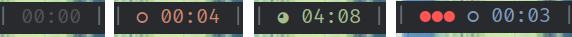

[Polybar](https://github.com/polybar/polybar)'s time management timers (pomodoro, stopwatch, timer) is an applet.

<p align="center">
    <br>
         
    <br>
</p>

## Features

- **pomodoro**
    - format: `[completed_pomodoros current_pomodoro time]` see pictures above
        - [      00:00 ] - idle
        - [    ◔ 08:13 ] - work
        - [    ◑ 02:42 ] - break
        - [ ●● ◔ 07:50] - completed two pomodoros
    - 25-minute work sessions
    - 5-minute short breaks
    - 15-minute long breaks after 4 pomodoros
    - Color-coded display (orange for work, green for break, blue for long break)
    - Click controls: start/pause,  reset, skip
    - Desktop notifications
    - Sound alerts
- **stopwatch** (like in leetcode.com)
    - It is just increses time from 00:00:00
    - Click controls: start/pause,  reset
    - Notify you every 10 minutes
    - Change color to more red every 20 minutes
- [NEW FEATURE] **timer** - 
    - It is just decreases time fron initial one
    - Click controls:
        - right click - add 10 minutes (00:10:00, 00:20:00, 00:30:00, etc.)
        - middle click - reset to 00:00:00
        - left click - start timer
    - When timer come to 00:00:00 it starts flashing red/blue

## Installation

1. Dependancies

- Ubuntu/Debian

```bash
sudo apt install python3-notify2 libcanberra-gtk3-module
```

- Arch Linux

```bash
sudo pacman -S python3-notify2 libcanberra
```

1. Clone the repository

```bash
git clone https://github.com/kirillin/polybar-pomodoro.git
```

2. Add module to Polybar `~/.config/polybar/config`


- for pomodoro module
```
[module/pomodoro]
type = custom/script
exec = python3 ~/polybar-pomodoro/pomodoro.py
click-left = python3 ~/polybar-pomodoro/pomodoro.py toggle
click-middle = python3 ~/polybar-pomodoro/pomodoro.py reset
click-right = python3 ~/polybar-pomodoro/pomodoro.py skip
tail = true
```

- for stopwatch module
```
[module/stopwatch]
type = custom/script
exec = python3 python3 ~/polybar-pomodoro/stopwatch.py
click-left = python3 ~/polybar-pomodoro/stopwatch.py toggle
click-right = python3 ~/polybar-pomodoro/stopwatch.py reset
tail = true
interval = 1
```

- for timer module
```
[module/timer]
type = custom/script
exec = python3 ~/polybar-pomodoro/timer.py
click-left = python3 ~/polybar-pomodoro/timer.py start
click-right = python3 ~/polybar-pomodoro/timer.py add
click-middle = python3 ~/polybar-pomodoro/timer.py reset
tail = true
interval = 1
label = %output%
```

3. Restart polybar

```bash
polybar-msg cmd restart
```

## Usage

- **pomodoro**: Left-click start/pause, Middle-click reset, Right-click skip
- **stopwatch**: Left-click start/pause, Right-click reset
- **timer**: Left-click start/pause, Middle-click reset, Right-click add 10 minutes


## Changelog

- 27.04.2026
    - add timer module
- 08.10.2025
    - add stopwatch module
    - change sound for the end of a pomodoro to to multiple times play
